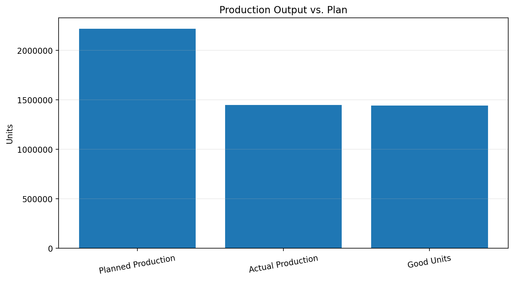
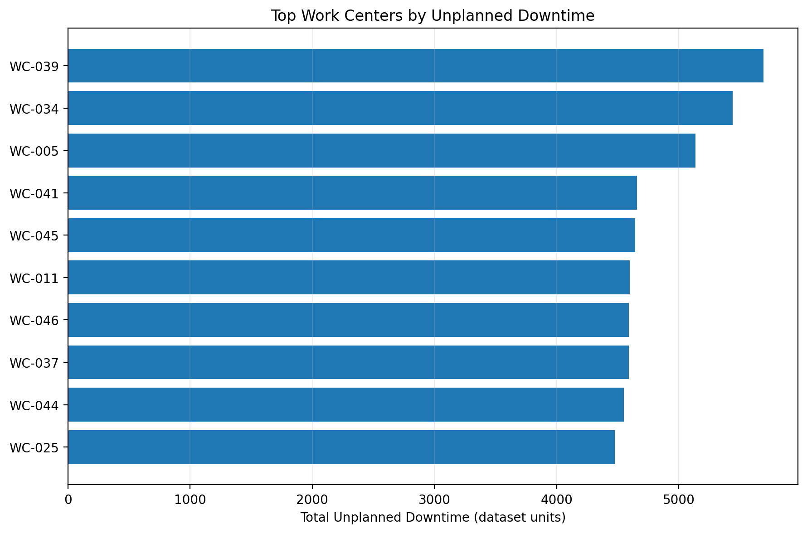
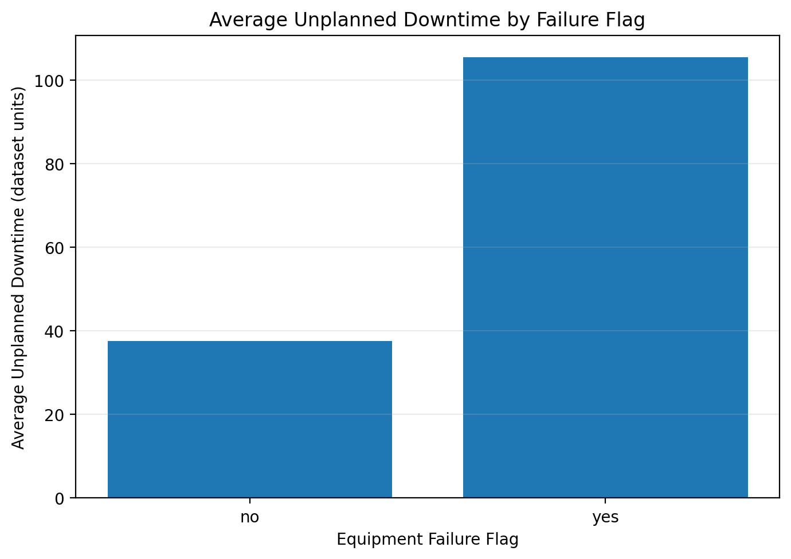

# Aerospace Automated Manufacturing Cell — OEE, Production & Automation Analytics

**Manufacturing Operations | Equipment Reliability | Production Analytics | SQL | Python**

## Project Overview

This project is a synthetic aerospace manufacturing case study designed to demonstrate how production, equipment reliability, maintenance, quality, and cost data can be transformed into actionable operational insights.

The analysis examines a simulated automated manufacturing environment involving material handling, robotic production operations, equipment inspection, and production support processes.

Using SQL and Python, the project evaluates production performance, unplanned downtime, equipment failure patterns, bottleneck stations, maintenance activity, product quality, and estimated cost exposure.

The objective is to demonstrate how data analytics can support manufacturing performance monitoring, maintenance planning, reliability improvement, and operational decision-making.

> **Data disclaimer:** This project uses synthetic manufacturing data. It does not contain actual Airbus, HII, Navy, or other commercial or government production records.

## Business Problem

Automated manufacturing operations depend on equipment availability, production throughput, quality control, and effective maintenance planning.

When production performance falls below plan, equipment experiences recurring downtime, or bottlenecks constrain throughput, operations teams need reliable information to prioritize corrective actions.

This project demonstrates an analytical approach to answering questions such as:

- How closely is production meeting planned output?
- Which work centers experience the highest unplanned downtime?
- How does equipment failure status relate to downtime?
- Which stations demonstrate potential bottleneck conditions?
- How do maintenance categories and equipment condition relate to downtime?
- Which work centers have the highest reported quality and downtime cost exposure?

## Dataset

**Dataset:** MFG-005 Synthetic Line Performance Dataset

**Source:** [Hugging Face — MFG-005 Sample Dataset](https://huggingface.co/datasets/xpertsystems/mfg005-sample)

| Attribute | Description |
|---|---:|
| Records analyzed | 3,000 |
| Dataset columns | 118 |
| Data type | Synthetic manufacturing operations |
| Database | SQLite |
| Analysis environment | Google Colab |

The dataset includes production quantities, work-center identifiers, equipment condition indicators, failure flags, downtime measurements, maintenance categories, bottleneck indicators, and quality and cost fields.

## Technology Stack

| Technology | Application |
|---|---|
| Python | Data analysis and visualization |
| Pandas | Data manipulation and aggregation |
| SQL | Operational queries and analysis |
| SQLite | Relational data storage |
| Matplotlib | Data visualization |
| Google Colab | Cloud-based development environment |
| GitHub | Project documentation and portfolio management |

## Analytical Methodology

The project includes seven analytical workstreams.

### 1. Production Performance
Evaluated planned production, actual production, good units, defective units, and scrap quantities.

### 2. Work Center Downtime
Ranked work centers by total and average unplanned downtime to identify operational areas requiring further investigation.

### 3. Equipment Failure Analysis
Compared equipment records with and without a failure flag, examining average downtime, total downtime, and equipment condition.

### 4. Bottleneck Analysis
Evaluated bottleneck station identifiers, cycle times, utilization percentages, and cycle-time losses.

### 5. Maintenance and Equipment Condition
Compared planned and unplanned maintenance records across preventive, predictive, corrective, and emergency maintenance categories.

### 6. Production Quality
Examined good units, defective units, first-pass yield indicators, and defect-rate measurements by work center.

### 7. Downtime and Quality Cost Analysis
Ranked work centers using reported downtime and cost-of-poor-quality fields, including scrap and rework costs.

## Executive Findings

### Production Performance

| Metric | Result |
|---|---:|
| Planned production | 2,219,673 |
| Actual production | 1,448,365 |
| Good units | 1,444,421 |
| Defective units | 3,944 |
| Scrap units | 393 |
| Production target achievement | 65.25% |
| Calculated good-unit rate | 99.73% |

Production achieved 65.25% of planned output, indicating a gap of 771,308 units between planned and actual production.

The calculated good-unit rate was 99.73% of actual production.

### Equipment Reliability

| Equipment record category | Records | Average unplanned downtime |
|---|---:|---:|
| Failure flag: Yes | 1,154 | 105.41 |
| Failure flag: No | 1,846 | 37.56 |

Records with an equipment failure flag showed approximately 2.81 times the average unplanned downtime of records without a failure flag.

This association identifies a useful area for additional reliability analysis; it does not establish that the failure flag alone caused the downtime difference.

### Work Center Downtime

The highest-ranked work centers included:

- WC-039: 5,690.89 downtime units
- WC-034: 5,439.38 downtime units
- WC-005: 5,136.43 downtime units
- WC-041: 4,657.90 downtime units
- WC-045: 4,642.80 downtime units

WC-039 ranked highest in the analyzed work centers for total unplanned downtime.

### Bottleneck Analysis

The bottleneck analysis identified stations with high average cycle times and utilization.

WC-002 and WC-001 were notable high-volume stations, with 645 and 706 records respectively.

Stations with very few records require additional validation before operational prioritization.

### Cost Exposure

WC-039 ranked highest in the supplied cost-analysis results:

| Cost category | Amount |
|---|---:|
| Downtime cost | $802,824.16 |
| Cost of poor quality | $161,571.50 |
| Combined reported cost exposure | **$964,395.66** |

These figures are synthetic dataset values and are not actual financial losses or company cost records.

## Visualizations

The project includes the following charts:

### Production Output vs. Plan


### Work Center Downtime


### Equipment Failure and Downtime


## Repository Structure

```text
aerospace-automated-cell-oee-analytics/
│
├── Data/
│
├── Documentation/
│   └── PROJECT_MANIFEST.txt
│
├── SQL/
│
├── Python/
│
├── Dashboard/
│
├── Results/
│   ├── production_performance_results.csv
│   ├── work_center_downtime_results.csv
│   ├── equipment_failure_analysis.csv
│   ├── bottleneck_station_analysis.csv
│   ├── maintenance_condition_analysis.csv
│   ├── production_quality_analysis.csv
│   └── downtime_quality_cost_analysis.csv
│
├── Visualizations/
│   ├── production_output_vs_plan.png
│   ├── work_center_downtime.png
│   └── equipment_failure_downtime.png
│
└── README.md
```

## Operational Applications

The analytical approach demonstrated in this project can support:

- Production performance monitoring
- Equipment reliability assessment
- Preventive and predictive maintenance planning
- Work-center prioritization
- Bottleneck identification
- Quality performance monitoring
- Manufacturing cost analysis
- Data-driven operational reporting

## Limitations and Future Development

The current analysis is descriptive and uses synthetic data. Relationships between maintenance, failures, downtime, and quality should not be interpreted as proof of causation.

Future development opportunities include:

1. Implementing a validated Overall Equipment Effectiveness (OEE) calculation.
2. Developing an interactive executive dashboard.
3. Adding downtime Pareto analysis.
4. Developing equipment failure prediction models.
5. Evaluating maintenance optimization opportunities.
6. Building automated production and reliability reporting.
7. Adding reproducible SQL scripts and Python notebooks.

## Professional Skills Demonstrated

**Technical:** Python, SQL, SQLite, Pandas, data validation, data aggregation, data visualization, and operational analytics.

**Manufacturing:** Production performance, equipment reliability, preventive maintenance, predictive maintenance concepts, quality analysis, bottleneck analysis, and downtime investigation.

**Business Applications:** KPI reporting, operational decision support, cost exposure analysis, and process improvement.

## Author

**Harold Wanton**

Aerospace Manufacturing | Mechanical Maintenance | Operations & Data Analytics

GitHub: [https://github.com/hwant2](https://github.com/hwant2)

---

*This portfolio project demonstrates the application of data analytics to synthetic aerospace manufacturing and equipment reliability scenarios.*
